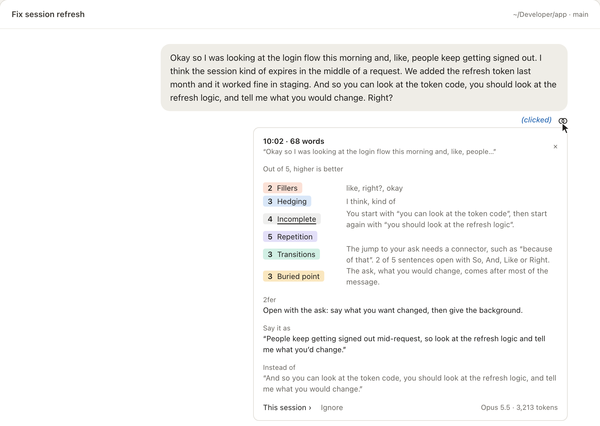
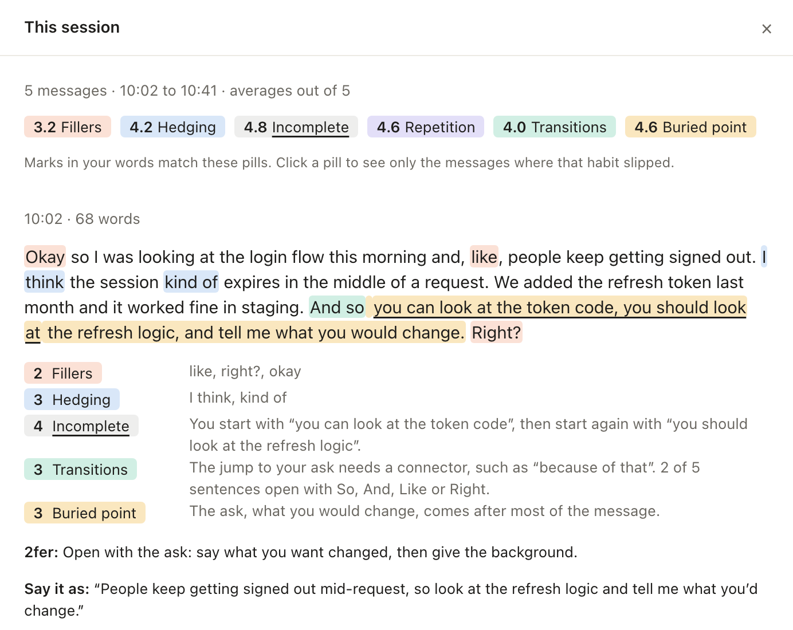
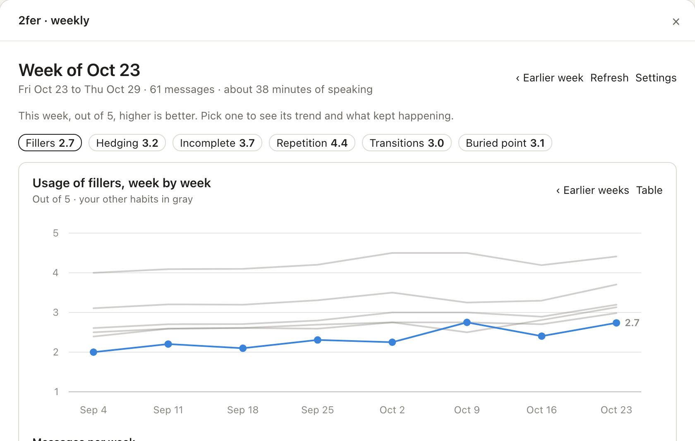

## 2fer, the mindset

What's a 2fer? It's one piece of work that benefits two things, driving outsized impact. When I took on an organization a few years ago, it was in a lot of flux. There was so much to do and so many fires to put out that it was very difficult to prioritize. So a tenet became that we only pick up 2fers or 3fers. For a while, that's all we picked, because one thing kept leading to improvements in two or more things.

Some 2fers are clear. Retire the legacy service lurking in the corner: you are able to remove some infrastructure expense, gaining margins, and the dev team is happier because they didn't want to maintain it anyway. Others require creativity to identify. Modernizing your pipelines is one approach. Modernizing them in a way that new region builds also become faster is a different approach, and nobody hands you that version of the project. You have to go looking for it. So force yourself to find 2fers. It takes some mental exercise, and once you get some practice, you'll be addicted to it. That exercise works outside an organization too. A few weeks ago, I found a 2fer in how I spend my day.

## 2fer, the plugin

The vast majority of my work is now speaking my intent to Claude Code. In October alone, that was about 70,000 words, and on my busiest days, about 50 minutes of talking. I also want to get better at public speaking: removing speech fillers, constructing my sentences clearly, and highlighting my thought process. I felt there was an opportunity. Every message I dictate could do two things: get my work done, and train me to speak more clearly. Unsurprisingly, I picked 2fer as the name for this.

My take is that there's immense value in doing this inline, where the work happens. A separate app or a daily summarizer isn't enough. One competes for your time, and the other doesn't give you the live feedback that makes practice effective. Recently launched Claude Code mods[^mods] were the right tool for it. A mod is a plugin with code that runs inside Claude Code, so it can draw a note under a message and make its own model call. The coaching stays out of the conversation, and it doesn't dilute the work Claude is doing.

The results were surprising. I had gotten comfortable being unclear when I speak. Nearly half of my messages had a hedge, like "I think" or "maybe". In long messages, the clean version of my ask was often my last sentence, so the listener carried all of the setup without knowing what it was for. My use of So and And to begin sentences surprised me the most. About one in five of my sentences started that way[^counts], and in one message, it was 16 of 39. Here's how 2fer summed up the pattern:

> You often move to your next point with a vague 'So' or 'And', or no link at all, leaving your listener to work out whether it is a reason, a contrast, or a next step.

Claude also highlighted that this has gotten worse. When I answered live questions in a talk on YouTube a year ago, it was about one in seven[^live]. The nature of talking to an agent and being lax about delivery was making my public speaking worse. One important distinction: the focus here is delivery, not the quality of the content. A message can fall short in two ways. It can lack content, like "We should fix onboarding because it matters to customers." That's a thinking problem, and 2fer doesn't touch it. Or it can lack structure, like this one of mine: "I haven't seen I didn't see anything pop up after I clicked on it. So what's the problem? I didn't see any pop". Here, 2fer highlighted the unnecessary repetition, and a sentence transition that's difficult to follow. That second problem is the only one it works on.

## 2fer, the design

It stays out of the way until you want it. When you send a dictated message, a small two-ring mark appears under it. Nothing is added to the conversation, and Claude never sees the feedback. If you're in the flow, ignore it. If you're curious, there are three levels: a/ *This message:* Hover over the mark for the scores. Click it for a card with a note on each habit, a rewrite, and the one change that would fix the most. b/ *This session:* The card opens a pane with every message you've dictated in the session, each habit marked in your own words. c/ *This week:* */2fer* opens your weekly trends: a score for each habit, a chart by week, what kept happening, and your best message.

  

*These are renderings from 2fer's own drawing code, with made-up messages and a made-up week. Click an image to see all of it at full size.*

2fer scores six habits out of 5: fillers, hedging, incomplete sentences, unnecessary repetition, unclear transitions, and buried point. I built it for myself, so this is how it works for me, and your mileage will vary. You can customize it easily, because the habits and their rules are in one file[^catalog]. Mine allow for thinking aloud: an idea that comes to you as you speak isn't a buried point or an unclear transition. A sentence or two of context before an ask is fine, because people aren't transactional. And a summary at the end isn't repetition.

The cost is small, and it doesn't build up. Each note is one request on your Claude plan or API bill, and it carries that one message and nothing else. On Sonnet 5.5, the default, that's about 3,000 tokens for a 50-word message and 4,000 for a 300-word one. Opus 5.5 uses about the same tokens at twice the price, and Haiku 5.5 at a twentieth. With no model, 2fer still counts fillers and hedging, for free. Every note shows the tokens it used.

You can use it too. In a terminal, run *claude plugin install 2fer --marketplace gurinder-raju/2fer*, with nothing to set up. In the desktop app, click "+" next to the prompt box, then "Plugins", then "Add marketplace" with *gurinder-raju/2fer*, then "Add plugin". It's open source on GitHub[^repo], and it works with English dictation. I've only used it for a few weeks, and I haven't looked at the results on a longer horizon. If you try it, I'd like to hear what it gets wrong, and contributions are welcome. In the meantime, every message I dictate gets my work done and gives me practice. That's the 2fer mindset: find opportunities to benefit multiple things from one piece of work.

[^mods]: Claude Code docs: [Mods overview](https://code.claude.com/docs/en/plugins/mods).

[^counts]: Counted across 771 messages I dictated from June through October, about 5,800 sentences, leaving out pastes and anything under 15 words.

[^live]: 7 of the 52 sentences in my live answers, from the auto-generated transcript of [the talk on YouTube](https://www.youtube.com/watch?v=jVOKbwWnHM0). That's a small sample, and captions punctuate differently from dictation, so treat it as a rough comparison.

[^catalog]: [hooks/catalog.ts](https://github.com/gurinder-raju/2fer/blob/main/hooks/catalog.ts) in the 2fer repo.

[^repo]: [2fer on GitHub](https://github.com/gurinder-raju/2fer), under an MIT license.
